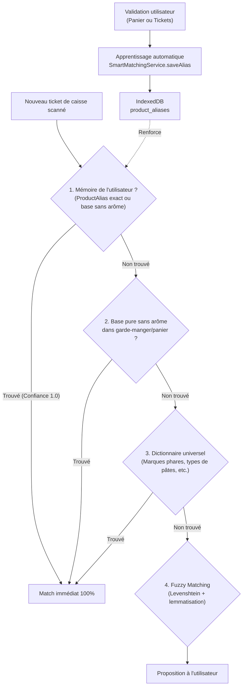

# Architecture de Synchronisation des Tickets & Apprentissage Intelligent

Ce document détaille le fonctionnement, l'architecture technique et les mécanismes de l'assistant de courses pour la réconciliation des tickets de caisse, la protection anti-doublon et le système d'apprentissage continu par utilisateur.

---

## 1. Problématique & Objectifs

### Problème résolu
Lorsqu'un utilisateur effectuait ses courses :
1. Il scannait son ticket depuis **« Mon Panier »** : les articles étaient décomptés du panier, les prix étaient actualisés, et l'historique d'achats consignait l'achat avec l'identifiant du ticket (`receiptId`).
2. Plus tard, en consultant l'onglet **« Tickets »**, il cliquait sur *« Garde-manger »* pour synchroniser le ticket.
3. Auparavant, cette validation insérait une **seconde entrée d'achat** pour le même ticket et les mêmes articles, faussant les statistiques de consommation, le cycle d'achat et la fréquence.

De plus, les tickets de supermarché comportent des libellés cryptiques, des abréviations d'enseignes ou des mentions d'arômes (ex: `DN MIN 1.5L`, `DANUP FRAIS`, `SIC TOM COND`). Sans apprentissage, l'application devait redemander ou tenter de deviner à chaque scan.

### Objectifs atteints
- **Zéro doublon d'achat (Idempotence)** : Un même ticket (`receiptId`) ne peut jamais créer deux fois une entrée d'achat pour le même ingrédient.
- **Transparence visuelle** : L'utilisateur voit immédiatement dans la fenêtre de synchronisation quels articles proviennent déjà du panier via le badge `✓ Déjà validé via Panier`.
- **Apprentissage continu personnalisé** : L'application retient les associations validées par l'utilisateur (libellé brut → ingrédient propre) et s'améliore au fil des jours.
- **Abstraction sémantique des arômes** : Lorsqu'un produit à déclinaison (ex: `Danup vanille` ou `Dan-up mangue`) est associé à l'ingrédient générique `Danup`, l'assistant mémorise à la fois le libellé spécifique et la racine générique.

---

## 2. Architecture Anti-Doublon (Idempotence Transactionnelle)

### Principe d'Idempotence par Empreinte `receiptId + ingredientId`

Chaque achat issu d'un ticket porte obligatoirement l'identifiant unique du reçu :
```typescript
export interface PurchaseRecord {
  date: string;
  quantity: number;
  unit: string;
  price?: number;
  store?: string;
  receiptId?: string;           // Identifiant unique du ticket scanné
  scannedFromReceipt?: boolean; // Marqueur d'origine
  receiptInfo?: string;         // Libellé court (ex: "Ticket Carrefour")
}
```

### 1. Lors du scan dans « Mon Panier » (`handleReconcileReceiptWithBasket`)
- L'application rapproche les articles du panier avec les lignes du ticket.
- Chaque article acheté est retiré ou décrémenté du panier.
- Une entrée `PurchaseRecord` est créée dans `purchaseHistory[basketItem.id]` avec `receiptId: receipt.id`.
- Le ticket `Receipt` est marqué avec `reconciledWithBasket: true` et `reconciledAt: ISO_DATE`.
- Chaque ligne réconciliée du ticket est annotée avec `line.reconciledWithBasket = true` et `line.ingredientId = basketItem.id`.
- L'association est immédiatement transmise au moteur d'apprentissage (`SmartMatchingService.saveAlias`).

### 2. Lors de la synchronisation depuis l'onglet « Tickets » (`handleSyncReceiptWithPantry`)
- L'application vérifie si une entrée avec ce `receiptId` existe déjà dans `purchaseHistory[ingredientId]` :
  ```typescript
  const existingIdx = newHistory[u.id].findIndex(r => r.receiptId === receipt.id);
  if (existingIdx !== -1) {
    // DÉJÀ PRÉSENT : Mise à jour du prix/magasin SANS créer de nouvel achat
    newHistory[u.id][existingIdx] = {
      ...newHistory[u.id][existingIdx],
      price: u.newPrice || existing.price,
      ...(store && !existing.store ? { store } : {}),
    };
  } else {
    // PREMIÈRE VALIDATION : Création normale du PurchaseRecord
    newHistory[u.id].push({
      date: now,
      quantity: u.line?.quantity ?? 1,
      unit: u.line?.unit || 'pièce',
      price: u.newPrice,
      receiptId: receipt.id,
      scannedFromReceipt: true,
      receiptInfo: store ? `Ticket ${store}` : 'Ticket scanné',
    });
  }
  ```

### 3. Expérience utilisateur dans `ReceiptSyncDialog`
- Si un article est déjà validé, il arbore le badge :
  `✓ Déjà validé via Panier`
- Une bannière d'information rassure l'utilisateur :
  > *« Protection anti-doublon active : Les articles marqués « Déjà validé via Panier » ont déjà été décomptés et ajoutés à votre historique lors du scan. Leur sélection permet uniquement d'actualiser le prix de référence du garde-manger sans créer de doublon d'achat. »*
- Sur la liste des tickets dans `ReceiptsView`, les tickets déjà réconciliés affichent un badge vert :
  `✓ Panier synchronisé`

---

## 3. Système d'Apprentissage Intelligent Évolutif

L'apprentissage est stocké localement par utilisateur dans la base de données IndexedDB via la clé `product_aliases`.

### Structure de données enrichie (`ProductAlias`)
```typescript
export interface ProductAlias {
  id: string;
  rawName: string;          // Libellé de caisse brut (ex: "DAN-UP VANILLE", "DN MIN 1.5L")
  ingredientId: string;     // ID de l'ingrédient canonique dans le garde-manger
  storeName?: string;       // Enseigne associée (ex: "Carrefour", "Monoprix", "Aziza")
  confidenceScore?: number; // Score de confiance appris (0.85 à 1.0)
  timesValidated?: number;  // Nombre de fois confirmé par l'utilisateur
  lastConfirmedAt?: string; // Date de dernière confirmation
}
```

### Fonctionnement de l'apprentissage



### Les règles de renforcement & d'abstraction
1. **Renforcement continu** : Chaque nouvelle validation d'un libellé incrémente `timesValidated` et augmente son `confidenceScore` jusqu'à 100%.
2. **Double mémorisation (Spécifique + Abstraction)** :
   Si l'utilisateur scanne `DANUP FRAISE 220G` et le valide vers `Danup` :
   - Le système mémorise l'alias spécifique : `danup fraise 220g` → `Danup`
   - Le système extrait la racine générique sans arôme (`danup`) et mémorise également l'alias générique : `danup` → `Danup`.
   - Ainsi, tout futur ticket contenant une autre variante (ex: `DANUP MANGUE`, `DANUP VANILLE`) sera automatiquement reconnu dès le premier scan !

---

## 4. Fichiers Modifiés & Références

| Fichier | Rôle |
|---|---|
| `src/lib/types.ts` | Enrichissement de `ProductAlias`, `ReceiptLine` et `Receipt` avec métadonnées de réconciliation |
| `src/lib/smart-matching.ts` | Enrichissement de `saveAlias`, intégration des alias appris en étape 1 de `findMatch` et `findMatchInBasket` |
| `src/components/KitchenAssistantPage.tsx` | Idempotence dans `handleSyncReceiptWithPantry`, marquage du ticket dans `handleReconcileReceiptWithBasket`, apprentissage continu |
| `src/components/ReceiptsView.tsx` | Transmission de `purchaseHistory`, affichage du badge `✓ Panier synchronisé` sur les tickets |
| `src/components/ReceiptSyncDialog.tsx` | Détection `alreadyValidatedFromBasket`, bannière d'information anti-doublon et badges visuels |

---
*Documenté pour le projet Mon-Assistant-Courses.*
